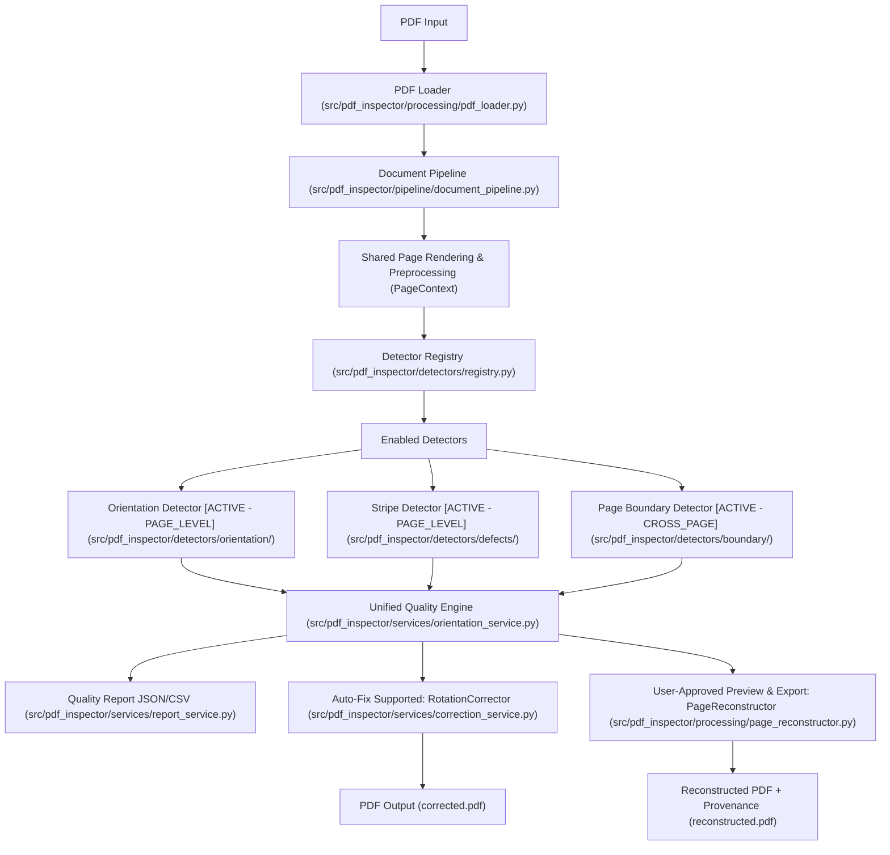

# Kiến trúc Hệ thống — Multi-Defect PDF Quality Inspection (Phase 3)

## 1. Tổng quan Kiến trúc

Dự án được thiết kế theo kiến trúc **Multi-Defect PDF Quality Inspection** nhằm cho phép kiểm tra tự động nhiều loại lỗi chất lượng trên tài liệu PDF scan mà người dùng không cần biết trước tài liệu gặp lỗi gì.

Ở **Phase 3**, hệ thống kích hoạt đầy đủ cả 3 bộ phát hiện lỗi độc lập nhưng dùng chung dữ liệu trang (`PageContext`) và quy trình điều phối thống nhất (`DocumentPipeline`):
1. **Orientation Detector (`ACTIVE` / `ENABLED` — `PAGE_LEVEL`):** Phát hiện trang bị xoay `90°`, `180°`, `270°` bằng Tesseract OSD kết hợp OpenCV.
2. **Stripe Detector (`ACTIVE` / `ENABLED` — `PAGE_LEVEL`):** Phát hiện vệt sọc máy scan (`VERTICAL`, `HORIZONTAL`, `DIAGONAL`, `BAND`) bằng sự kết hợp của 3 kỹ thuật Computer Vision (Morphological Operations, Probabilistic Hough Line Transform `HoughLinesP`, và Projection Profile / Intensity Analysis) kèm bộ lọc False Positive (`StripeValidator`).
3. **Page Boundary & Mixed-Page Detector (`ACTIVE` / `ENABLED` — `CROSS_PAGE`):** Phát hiện lỗi ranh giới trang và lẫn trang (`MIXED_PAGE`, `SPLIT_PAGE`, `CONTENT_OVERLAP`, `CONTENT_TRUNCATED`, `PAGE_BOUNDARY_SUSPECTED`) thông qua phân tích bố cục từng trang (`PageLayoutAnalysisResult`) kết hợp đối chiếu vùng biên liên trang `N-1`, `N`, `N+1` bằng cửa sổ trượt tiết kiệm RAM (`run_cross_page_validation`).



---

## 2. Cấu trúc Thư mục và Trách nhiệm Module

```text
src/pdf_inspector/
├── core/                            # Cấu hình, logging và ngoại lệ
│   ├── config.py
│   ├── logging_config.py
│   └── exceptions.py
├── pipeline/                        # Điều phối trung tâm toàn bộ luồng kiểm tra
│   └── document_pipeline.py
├── detectors/                       # Các thuật toán nhận diện lỗi chất lượng
│   ├── base_detector.py             # BaseDetector, PageLevelDetector, DocumentLevelDetector
│   ├── registry.py                  # DetectorRegistry & trạng thái AVAILABLE/ENABLED/DISABLED/NOT_IMPLEMENTED
│   ├── orientation/                 # Bộ nhận diện hướng trang [ACTIVE - Phase 1]
│   │   └── detector.py
│   ├── defects/                     # Bộ nhận diện lỗi vệt sọc scan [ACTIVE - Phase 2]
│   │   ├── line_candidate_detector.py
│   │   ├── stripe_validator.py
│   │   └── stripe_detector.py
│   └── boundary/                    # Bộ nhận diện lỗi ranh giới & lẫn trang [ACTIVE - Phase 3]
│       ├── layout_analyzer.py
│       ├── boundary_candidate_detector.py
│       ├── cross_page_validator.py
│       └── boundary_detector.py
├── processing/                      # Đọc PDF, render trang, tiền xử lý ảnh và tái tạo trang
│   ├── pdf_loader.py
│   ├── page_renderer.py
│   ├── image_preprocessor.py
│   └── page_reconstructor.py
├── services/                        # Nghiệp vụ tổng hợp chất lượng, chỉnh sửa và báo cáo
│   ├── orientation_service.py       # UnifiedQualityEngine (DecisionEngine)
│   ├── correction_service.py        # RotationCorrector (PDFCorrector)
│   ├── boundary_inspection_service.py # Điều phối xem trước & xuất PDF tái tạo có xác nhận
│   ├── report_service.py            # ReportGenerator (JSON/CSV)
│   └── pdf_service.py               # Re-export PDFLoader tương thích ngược
├── models/                          # Schema dữ liệu, PageContext và kết quả đa lỗi
│   ├── context.py                   # PageContext, CoordinateTransform, CoordinateSpace
│   ├── schemas.py                   # DefectResult, PageDecision, PipelineResult...
│   └── boundary_schemas.py          # BoundaryDefectCode, BoundaryStatus, BoundaryCandidate...
├── ui/                              # Giao diện Web Streamlit
│   ├── streamlit_app.py
│   └── components/
│       ├── sidebar.py
│       ├── results_view.py
│       └── preview_panel.py
└── utils/                           # Tiện ích chuẩn hóa góc xoay và đường dẫn file
    └── file_utils.py
```

| Nhóm Module | Trách nhiệm cốt lõi |
| :--- | :--- |
| `src/pdf_inspector/core/` | Quản lý cấu hình tập trung (`DetectorConfig` cho cả Orientation, Stripe và Boundary), biến môi trường, khởi tạo logging và hệ thống ngoại lệ. |
| `src/pdf_inspector/pipeline/` | `DocumentPipeline` điều phối toàn bộ vòng đời kiểm tra tài liệu: mở PDF, tạo `PageContext` từng trang, gọi `OrientationDetector` và `StripeDetector`, trích xuất đặc trưng bố cục nhẹ (`extract_page_layout`), giải phóng RAM bitmap ngay sau mỗi trang (`page_ctx.release()`), thực thi kiểm tra liên trang (`evaluate_document_boundaries`), tổng hợp qua `UnifiedQualityEngine`, xuất báo cáo và gọi `Correction`. |
| `src/pdf_inspector/detectors/defects/` | Chứa `line_candidate_detector.py`, `stripe_validator.py`, và `stripe_detector.py` (`StripeDetector` + `render_stripe_overlay`). |
| `src/pdf_inspector/detectors/boundary/` | Chứa `layout_analyzer.py` (phân tích khối chữ, dải khoảng trắng, vết ghép giấy, bước nhảy độ sáng nền, chữ cắt sát mép, bố cục 2 cột / sách mở đôi), `boundary_candidate_detector.py` (bộ lọc False Positive & `OptionalLayoutModelVerifier`), `cross_page_validator.py` (NCC, Projection Correlation, ORB feature matching, margin/height consistency giữa trang `N-1`, `N`, `N+1`), và `boundary_detector.py` (`PageBoundaryDetector` + `render_boundary_overlay`). |
| `src/pdf_inspector/processing/` | Đọc PDF tuần tự (`PDFLoader`), render trang (`page_renderer.py`), tiền xử lý ảnh (`image_preprocessor.py`), và xem trước / tái tạo trang có xác nhận (`page_reconstructor.py`). |
| `src/pdf_inspector/models/` | Định nghĩa `PageContext`, `CoordinateTransform` (hỗ trợ `RENDERED_IMAGE_PX`, `NORMALIZED`, `PDF_POINT` và quy đổi tọa độ ảnh xoay), `DefectResult`, `PageDecision`, `BoundaryCandidate`, `CrossPageMatchResult`, `ReconstructionProposal`. |
| `src/pdf_inspector/services/` | Tách biệt rõ các dịch vụ: tổng hợp chất lượng (`UnifiedQualityEngine`), xoay chỉnh sửa PDF (`RotationCorrector`), xem trước & phê duyệt tái tạo trang (`BoundaryInspectionService`), và xuất báo cáo (`ReportGenerator`). |
| `src/pdf_inspector/ui/` | Giao diện Streamlit hiển thị trạng thái 3 detector, bảng `Orientation / Stripe / Page Boundary Summary & Results Tables`, chế độ xem trước đa trang (`Trang trước N-1 | Hiện tại N | Trang sau N+1`), lớp phủ trực quan hóa sọc & ranh giới, xem trước tách/ghép trang và xuất `reconstructed.pdf` khi người dùng xác nhận. |
