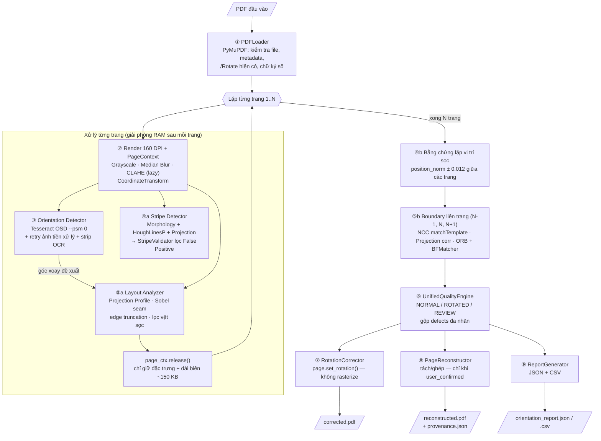
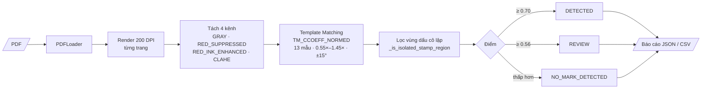

# Luồng Xử lý (Workflow) — Multi-Defect PDF Quality Inspection

Hệ thống có **2 luồng độc lập**, dùng chung `PDFLoader` và nền tảng PyMuPDF/OpenCV, chạy được từ Streamlit UI hoặc CLI:

| Luồng | Mục đích | Điểm vào |
|---|---|---|
| **A — Kiểm tra chất lượng scan** | Xoay trang, vệt sọc, ranh giới/lẫn trang | `DocumentPipeline.scan_document()` — `src/pdf_inspector/pipeline/document_pipeline.py` |
| **B — Nhận diện dấu độ mật** | MẬT / TỐI MẬT / TUYỆT MẬT / GIẢI MẬT | `SecretScanService.scan_pdf()` — `src/pdf_inspector/services/secret_scan_service.py` |

Luồng B không gọi Orientation / Stripe / Boundary Detector, và luồng A cũng không gọi Secret Detector.

---

## 1. Sơ đồ tổng quát — Luồng A

## 2. Sơ đồ — Luồng B (dấu độ mật)

---

## 3. Chi tiết từng bước — Luồng A

### ① Đọc & kiểm tra PDF — `processing/pdf_loader.py`
- **Kỹ thuật:** PyMuPDF (`fitz`).
- Kiểm tra file tồn tại, khác 0 byte, đúng chuẩn PDF, không bị khóa mật khẩu (`PasswordProtectedPDFError`, `InvalidPDFError`).
- Đọc metadata, số trang, góc `/Rotate` hiện có (`page.rotation`).
- Phát hiện chữ ký số. Nếu có, thêm cảnh báo: xoay trang có thể làm chữ ký trên file mới mất hiệu lực (file gốc vẫn giữ nguyên).

### ② Render & `PageContext` dùng chung — `processing/page_renderer.py`, `processing/image_preprocessor.py`, `models/context.py`
- **Render:** `page.get_pixmap(dpi=160)` → NumPy. Mỗi trang chỉ render **một lần**.
- `original_image` bị khóa ghi (`writeable = False`) để detector không sửa trực tiếp.
- **Tiền xử lý OpenCV** (khởi tạo lười, cache trong `PageContext`):
  - Chuyển xám (`cvtColor`).
  - Chuẩn hóa kích thước 800–2400 px (`INTER_AREA` khi thu nhỏ, `INTER_CUBIC` khi phóng to).
  - `processed_image`: **Median Blur** (khử nhiễu, giữ dấu tiếng Việt) + **CLAHE** (tương phản cục bộ).
  - `ensure_clahe()`: CLAHE **không** qua Median Blur, để giữ sọc mảnh 1–2 px cho Stripe Detector.
- **`CoordinateTransform`:** quy đổi hai chiều giữa `RENDERED_IMAGE_PX`, `NORMALIZED (0..1)`, `PDF_POINT`, và giữa ảnh đã xoay 90°/180°/270° với ảnh render gốc.

### ③ Phát hiện hướng trang — `detectors/orientation/detector.py`
- **Kỹ thuật:** Tesseract OSD (`--psm 0`), thử tối đa 3 lần:
  1. OSD trên ảnh xám gốc.
  2. Nếu UNKNOWN hoặc độ tin cậy thấp: OSD trên ảnh đã tiền xử lý.
  3. Nếu vẫn chưa chắc: **xác minh theo dải dòng chữ** (`_run_strip_ocr_verification`):
     - Nhị phân hóa **Otsu**.
     - **Morphological Close** với kernel 25×3 và 3×25 để nối ký tự thành dòng.
     - `connectedComponentsWithStats` → xác định trục chữ chính (ngang/dọc).
     - Cắt các dải dòng chữ, phóng 1.5×, OCR `--psm 6` (`image_to_data`) ở từng góc, chọn góc đọc tốt nhất.
- Nếu hai lần thử cho hai góc khác nhau, kết quả được gắn `has_conflict = True` và trang sẽ vào REVIEW ở bước ⑥.

### ④ Phát hiện vệt sọc máy scan — `detectors/defects/`
**a. Tìm ứng viên** (`line_candidate_detector.py`), kết hợp 3 phương pháp:

| Phương pháp | Kỹ thuật | Mạnh ở |
|---|---|---|
| Morphology | Ước lượng nền bằng `MORPH_CLOSE` → lấy residual → `MORPH_OPEN` kernel dọc/ngang theo kích thước trang & DPI → `connectedComponentsWithStats` | Sọc dọc/ngang rõ, dải sọc dày (band) |
| Hough | `cv2.HoughLinesP` + gộp các đoạn thẳng cùng phương nằm gần nhau | Sọc nghiêng, sọc đứt quãng |
| Projection Profile | Hồ sơ cường độ theo hàng/cột so với nền cục bộ, tìm đoạn hoạt động dài nhất | Sọc mờ, tương phản thấp |

Cuối tầng này, các ứng viên trùng nhau giữa 3 phương pháp được gộp và khử trùng lặp (`merge_and_deduplicate_candidates`).

**b. Lọc báo nhầm** (`stripe_validator.py`):
- Ước lượng lề nội dung (`ContentMargins`). Sọc scan thật thường vượt ra ngoài lề, còn đường kẻ của văn bản nằm trong lề.
- Loại bỏ các đường hợp lệ: lưới bảng, khung biểu mẫu, gạch chân, Quốc hiệu/Tiêu ngữ, header/footer, đường phân cách mục, chữ ký, viền giấy.
- Chấm điểm có giải thích (`HorizontalStripeScore` + `reason_codes`) và phân 3 mức: `SCAN_STRIPE`, `LIKELY_DOCUMENT_LINE`, `REVIEW`. Điểm này là heuristic, không phải xác suất đã hiệu chỉnh.

**c. Bằng chứng liên trang** (`StripeDetector.apply_cross_page_repetition_evidence`, chỉ khi có ≥ 2 trang): sọc xuất hiện ở cùng vị trí (`position_norm ± 0.012`) trên nhiều trang thì điểm nghi ngờ được nâng lên, vì lỗi đầu đọc scan thường lặp lại đúng chỗ.

- **Kết quả:** `CLEAN`, `STRIPE_DETECTED`, `REVIEW` hoặc `PROCESSING_ERROR`, kèm bbox theo pixel và PDF point. Lớp phủ xem trước được vẽ bằng `render_stripe_overlay` (`cv2.addWeighted`).

### ⑤ Phát hiện lỗi ranh giới & lẫn trang — `detectors/boundary/`
**a. Phân tích bố cục từng trang** (`layout_analyzer.py`, gọi qua `extract_page_layout(page_ctx, recommended_rotation_cw)`):
- Chạy trên ảnh đã xoay theo góc mà bước ③ đề xuất (chỉ khi độ tin cậy đạt ngưỡng).
- **Projection Profile** ngang/dọc → khối chữ (`TextRegionBlock`), dải trắng lớn (`WhitespaceBand`).
- **Sobel** → vết ghép giấy (`has_seam_line`, `seam_strength`) và bước nhảy độ sáng nền (`illumination_delta`).
- Phát hiện nội dung sát mép bị cắt (`EdgeTruncationSignal`).
- Nhận biết bố cục hợp lệ: 2 cột, trang sách đôi, bảng dài, vùng chữ ký.
- Loại vệt sọc khỏi mặt nạ nhị phân trước khi tính projection, để trang vừa có sọc vừa lẫn trang vẫn bắt được cả hai lỗi.
- Chỉ giữ đặc trưng hình học nhẹ và dải ảnh biên trên/dưới thu nhỏ (~150 KB/trang), rồi `page_ctx.release()`.

**b. Sinh & kiểm định ứng viên** (`boundary_candidate_detector.py`):
- Loại các trường hợp dễ báo nhầm: `paragraph_spacing`, `section_gap`, `table_grid_border`, `content_divider_rule`, `text_underline`, `signature_block`, `two_column_layout`, `valid_book_spread`.
- `OptionalLayoutModelVerifier` (tắt mặc định, bật bằng `BOUNDARY_USE_OPTIONAL_LAYOUT_MODEL`): dùng `pytesseract.image_to_string` tìm header/footer/số trang nằm giữa trang. Chỉ chạy khi có ứng viên nghi vấn.

**c. Đối chiếu liên trang** (`cross_page_validator.py`): cửa sổ trượt so sánh trang N với N−1 và N+1:
- **NCC:** `cv2.matchTemplate` với `TM_CCOEFF_NORMED` để tìm nội dung trùng lặp.
- **Tương quan Horizontal/Vertical Projection Profile.**
- **ORB + BFMatcher:** đối sánh đặc trưng cục bộ, kiểm tra các điểm khớp có cùng một hướng dịch chuyển hay không (inliers).
- Kiểm tra độ đồng nhất lề văn bản và tổng chiều cao khi ghép.
- Đối chiếu xong thì `release_strips()` giải phóng các dải ảnh biên.

**d. Ra quyết định** (`boundary_detector.py`). Một trang có thể mang nhiều nhãn cùng lúc (multi-label):

| Nhãn lỗi | Ý nghĩa |
|---|---|
| `MIXED_PAGE` | Một trang PDF chứa cuối trang A + đầu trang B (hoặc 2 tờ bị kéo chồng trong khay ADF) |
| `SPLIT_PAGE` | Một trang giấy bị tách thành 2 trang PDF liên tiếp |
| `CONTENT_OVERLAP` | Hai trang liền kề trùng lặp dải nội dung ở vùng biên |
| `CONTENT_TRUNCATED` | Nội dung sát mép (TOP/BOTTOM/LEFT/RIGHT) bị cắt mất |
| `PAGE_BOUNDARY_SUSPECTED` | Ranh giới nghi vấn, cần người kiểm tra |

Giá trị `boundary_status` có thể là: `NORMAL`, `BOUNDARY_SUSPECTED`, `MIXED_PAGE_DETECTED`, `RECONSTRUCTABLE`, `MISSING_CONTENT`, `REVIEW`, `PROCESSING_ERROR`.

### ⑥ Tổng hợp quyết định — `services/orientation_service.py` (`UnifiedQualityEngine`)
- **Quy tắc hướng trang:**
  - `REVIEW` khi kết quả UNKNOWN, **hoặc** độ tin cậy < ngưỡng (mặc định `10.0`), **hoặc** `has_conflict`.
  - Còn lại: góc 0° là `NORMAL`, các góc khác là `ROTATED`.
- Gộp lỗi từ mọi detector vào `PageDecision`, phân biệt rõ:
  - `NO_DEFECT`: đã kiểm tra, không có lỗi;
  - `NOT_CHECKED`: chưa kiểm tra;
  - `DETECTOR_FAILED`: detector gặp lỗi (không bao giờ được tính là "sạch");
  - `CONFIRMED` / `SUSPECTED_LOW_CONFIDENCE`.
- `inspection_status` của trang: `COMPLETED`, `COMPLETED_WITH_REVIEW`, `PARTIAL_FAILURE`, `FAILED`.
- Quyết định được tính lại sau bước ④b và ⑤b, vì hai bước đó bổ sung bằng chứng liên trang.

### ⑦ Sửa lỗi xoay — `services/correction_service.py` (`RotationCorrector` / `PDFCorrector`)
- `page.set_rotation()` chỉ cập nhật metadata `/Rotate` (modulo 360), **không rasterize lại**, nên giữ nguyên chất lượng PDF.
- Chỉ xoay trang `ROTATED` khi bật `auto_fix`, hoặc trang được người dùng chọn góc thủ công (`manual_override`).
- **Không bao giờ** tự xoay trang `REVIEW`, và không ghi đè file gốc. Đầu ra: `data/outputs/corrected.pdf`.
- `DocumentPipeline.update_decisions_and_artifacts()` tính lại quyết định, PDF và báo cáo khi người dùng đổi ngưỡng hoặc chọn góc thủ công, **mà không chạy lại detector**.

### ⑧ Xem trước & tái tạo trang — `processing/page_reconstructor.py`, `services/boundary_inspection_service.py`
- Không bao giờ tự động cắt/ghép trang trong lúc quét.
- `find_safe_cut_line_px` dời đường cắt vào rãnh trắng gần nhất, để không cắt ngang chữ (`crosses_text = False`).
- Xem trước bằng `preview_split_single_page` (tách) hoặc `preview_reconstruct_with_adjacent_page` (ghép / khử trùng lặp).
- Chỉ khi `user_confirmed = True` mới xuất `data/outputs/reconstructed.pdf` (PyMuPDF `new_page` + `insert_image`), kèm truy vết nguồn gốc `source_regions` trong `data/outputs/reconstruction_provenance.json`.
- Từ chối tái tạo trang `MISSING_CONTENT` (`REQUIRES_RESCAN`), không suy diễn nội dung bị mất.
- Phản hồi người dùng được lưu vào `data/outputs/boundary_review_feedback.json`.

### ⑨ Báo cáo — `services/report_service.py` (`ReportGenerator`)
- `orientation_report.json`: gồm `summary`, `stripe_summary`, `boundary_summary`, `inspection_scope`, `enabled_detectors`, `unsupported_checks`, `defects`, `stripe_defects`, `boundary_defects`.
- `orientation_report.csv`: mỗi trang một dòng.
- Không bao giờ kết luận tài liệu "sạch hoàn toàn" nếu còn kiểm tra chưa được thực hiện.

---

## 4. Chi tiết — Luồng B (dấu độ mật)

`detectors/secret/secret_detector.py` + `services/secret_scan_service.py`

| Bước | Kỹ thuật |
|---|---|
| Render | 200 DPI từng trang, giải phóng mảng ảnh ngay sau mỗi trang |
| Tách kênh màu | `GRAY`, `RED_SUPPRESSED`, `RED_INK_ENHANCED`, `CLAHE_ENHANCED`: bắt dấu đỏ, dấu đen, dấu bị con dấu tròn đè lên, dấu mờ |
| Template Matching | `cv2.matchTemplate` (`TM_CCOEFF_NORMED`) + `minMaxLoc`, 13 mẫu trong `detectors/secret/templates/` |
| Đa tỷ lệ / góc | Tỷ lệ 0.55×–1.45×; khử nghiêng ±15° bằng `getRotationMatrix2D` + `warpAffine`; `findContours` / `HoughLinesP` tìm khung dấu |
| Chống báo nhầm | `_is_isolated_stamp_region` kiểm tra vùng trống hai bên, để không nhận nhầm "mật", "BẢO MẬT", "BÍ MẬT", "MẬT ĐỘ" trong văn bản thường |
| Phân loại | `DETECTED` (≥ 0.70), `REVIEW` (≥ 0.56), `NO_MARK_DETECTED`, `PROCESSING_ERROR` |

**Bảo mật:** không ghi nội dung tài liệu vào log, không lưu ảnh crop xuống ổ đĩa, không tự tách PDF; chỉ xuất báo cáo JSON/CSV.

---

## 5. Nguyên tắc thiết kế xuyên suốt

1. **Detection tách khỏi Correction:** detector chỉ phát hiện và đề xuất; việc sửa chỉ làm thao tác được hỗ trợ; tách/ghép trang phải có người dùng xác nhận.
2. **Không chắc thì đưa vào REVIEW**, không tự động sửa.
3. **Tiết kiệm RAM:** xử lý tuần tự từng trang, render một lần dùng chung, giải phóng ngay sau khi xong.
4. **Lỗi không bị che giấu:** detector gặp ngoại lệ sinh `DETECTOR_FAILED`, không bao giờ coi là `NO_DEFECT`.
5. **Dễ mở rộng:** kế thừa `PageLevelDetector` / `DocumentLevelDetector` (`detectors/base_detector.py`) rồi đăng ký vào `DetectorRegistry` (xem `docs/detector_interface.md`).
6. **Chạy offline trên CPU:** toàn bộ dùng OpenCV + Tesseract, không cần mô hình deep learning.

## 6. Ngưỡng cấu hình chính (`core/config.py`, ghi đè được qua biến môi trường)

| Biến | Mặc định | Dùng ở |
|---|---|---|
| `RENDER_DPI` | 160 | ② Render |
| `ORIENTATION_CONF_THRESHOLD` | 10.0 | ③ / ⑥ Orientation |
| `STRIPE_CONFIRM_THRESHOLD` / `STRIPE_REVIEW_THRESHOLD` | 0.62 / 0.42 | ④ Stripe |
| `BOUNDARY_CONFIRM_THRESHOLD` / `BOUNDARY_REVIEW_THRESHOLD` | 0.64 / 0.42 | ⑤ Boundary |
| `BOUNDARY_OVERLAP_THRESHOLD` | 0.68 | ⑤c Overlap |
| `SECRET_RENDER_DPI` | 200 | Luồng B |
| `SECRET_CONFIRM_THRESHOLD` / `SECRET_REVIEW_THRESHOLD` | 0.70 / 0.56 | Luồng B |
| `AUTO_FIX` | false | ⑦ Correction |
